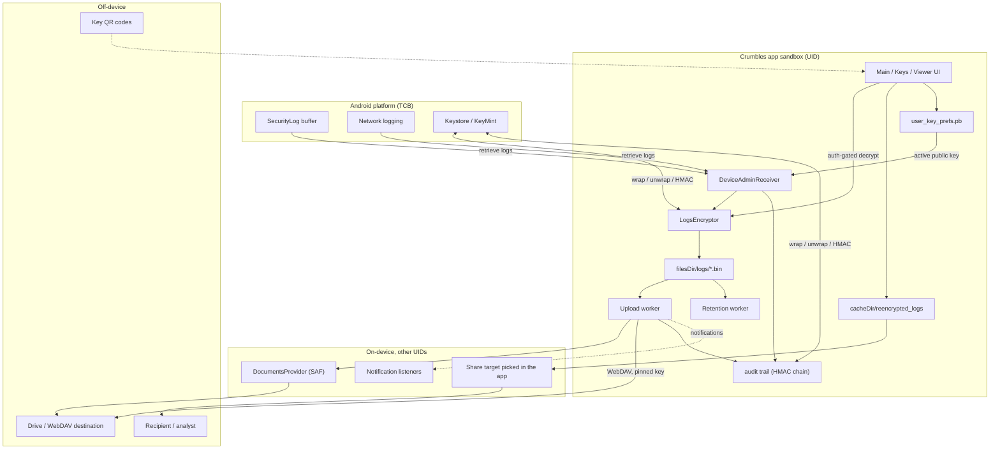

# Crumbles — Security and Privacy Threat Model

<!-- The tables below are wider than 80 columns by necessity. -->
<!-- disableFinding(LINE_OVER_80) -->

**Subject:** the Crumbles Android application (`com.android.securelogging`).

**Revision:** 2026-11-08 (v1.0), covering the v1.0 codebase and its weakness
register.

**Method:** asset-centric decomposition, then STRIDE per trust boundary, with
LINDDUN-style privacy threats considered separately. Privacy is a primary goal
of this product, not a side-effect of security, so the two are tracked
independently.

**Audience:** contributors changing security-relevant code, and reviewers
assessing whether a change weakens an existing guarantee.

## 1. Overview

Crumbles is an Android **Device Owner** application, or a logging delegate of
one, that collects platform Security Logs and Network Logs — telemetry normally
reserved for enterprise device management — on behalf of the device's *own*
user. Each batch is encrypted with hybrid envelope encryption and exported to a
destination the user chooses, for later forensic analysis by a party the user
trusts.

The intended users are people at elevated risk of targeted compromise:
journalists, human rights defenders, activists, and the security teams
supporting them. That changes the threat model considerably compared with an
enterprise management agent:

- The adversary may be a **well-resourced actor** with mobile exploit
  capability, legal compulsion powers, and physical access to the device.
- The **user may be coerced** — border seizure, forced unlock, duress.
- **Metadata is as sensitive as content.** Knowing that a particular device ran
  a counter-surveillance tool at a particular time is itself actionable.
- **Destroying the evidence trail** is as damaging as reading it. Integrity and
  availability of the log trail rank alongside confidentiality.

## 2. System Decomposition

### 2.1 Components

Java paths are relative to `src/main/java/com/android/securelogging/`.

| Component | Files | Role |
| :-- | :-- | :-- |
| Admin receivers | `CrumblesDeviceAdminReceiver.java`, `CrumblesDelegatedAdminReceiver.java`, `CrumblesDirectBootStore.java`, `CrumblesBootRecord.java` | Device Owner and delegate callbacks; enables logging after provisioning; retrieves logs, resolves the active key, encrypts, signs and persists batches; stages logs and alerts when no key resolves; collects security logs before the first unlock and reports restarts that may have lost logs |
| Crypto core | `CrumblesLogsEncryptor.java` | AES-256-GCM and RSA key wrap; Keystore key lifecycle; padding taken from the key's Keystore properties (PKCS#1 v1.5 only for built-in keys made by older versions); associated data; DataStore entry sealing; public-key validation and fingerprints |
| Batch signing and unwrap keys | `CrumblesBatchSigner.java`, `CrumblesBatchSigningKey.java`, `CrumblesBatchKeyStore.java` | Attested ECDSA P-256 signature and sequence number on each batch; batch-wrap keys, so that one authentication unwraps many batches |
| Staging and quota | `CrumblesLogStaging.java`, `CrumblesLogStagingSealer.java`, `CrumblesLogStorageQuota.java` | Sealed 16 MiB staging while no key is usable; 256 MiB cap that never evicts batches not yet uploaded |
| Key preferences | `CrumblesExternalPublicKeyManager.java`, `CrumblesDataStoreHolder.java`, `src/main/proto/user_key_prefs.proto` | External and re-encryption public keys, the active-key pointer and the storage config in `user_key_prefs.pb` |
| Key management UI | `CrumblesManageExternalKeysActivity.java`, `CrumblesPrivateKeyViewerDialogFragment.java` | Generate internal or exportable key pairs, custody confirmation, QR import with fingerprint confirmation, key rotation and the fate of pending batches |
| Re-encryption keys UI | `CrumblesReEncryptKeysActivity.java` | Import and select analyst keys for re-encryption |
| QR | `CrumblesQrScannerActivity.java`, `CrumblesBarcodeEncoder.java` | Camera ingest of keys (CameraX and ZXing); QR rendering of exported keys |
| Main UI | `CrumblesMain.java` | Logging switch, upload destination selection, decrypt-and-view flow |
| Decrypted viewer | `CrumblesDecryptedLogsActivity.java`, `CrumblesDecryptedLogsSession.java`, `CrumblesDecryptedLogEntry.java` | In-process plaintext session; re-encrypt and share to an analyst key |
| Upload and retention | `CrumblesSendAndMarkProcessingWorker.java`, `CrumblesDeleteSentFilesWorker.java`, `CrumblesUploadAndWipeWorker.java`, `CrumblesWorkScheduler.java` | Periodic upload, `.bin` to `_processing.bin` to `_sent.bin`; `_sent.bin` copies re-sent if missing from the folder and deleted 7 days after upload; upload now and wipe |
| Remote uploaders | `RemoteStorageUploader.java`, `GoogleDriveStorageUploader.java`, `WebDavStorageUploader.java`, `WebDavServerKeyPin.java` | Destination abstraction; SAF folder writes read back by SHA-256; WebDAV `PUT` over HTTPS to a server whose key the user confirmed |
| Share callback | `CrumblesShareResultReceiver.java` | Chooser result to `_sent.bin`; removed in v1.0 |
| Device identity | `CrumblesDeviceIdManager.java` | Per-installation UUID by default; serial or Android ID only when opted in |
| Audit trail | `audit/CrumblesAppAuditLogger.java`, `audit/CrumblesAuditEvent.java`, `audit/CrumblesAuditRecordSealer.java`, `audit/CrumblesAuditLogViewer*.java` | JSONL in `noBackupFilesDir`, records sealed with AES-256-GCM, keyed HMAC chain, two files of up to 1 MiB; unshipped records and the chain head travel in batches |
| Watchdog and heartbeat | `CrumblesLoggingWatchdogWorker.java`, `CrumblesHeartbeatWorker.java` | Records and alerts when logging is turned off or access is lost; an empty signed batch when no batch was signed for a while |
| Coercion and hand-over | `CrumblesSyncNowTileService.java`, `CrumblesKeyHandover.java`, `CrumblesLauncherEntry.java` | Sync now tile (upload and wipe); key hand-over record for the holder of the outgoing key; neutral launcher alias |
| Wire format | `src/main/logs.proto` | `LogBatch { LogData, LogKey, LogMetadata, sequence_number, BatchSignature }`; in format v2 the cleartext `LogMetadata` holds only the padded size and encryption type, and `SealedLogs` seals the timestamp, device identifier and attestation chain |
| Provisioning and build | `tools/generate_qr_payload.sh`, `setup_device.*`, `build_and_install.sh`, `build.gradle.kts` | Zero-touch QR payload; ADB fallback with SHA-256 check; Gradle build |

### 2.2 Data flow

### 2.3 Trust boundaries

| # | Boundary | Crossing | Assumption |
| :-- | :-- | :-- | :-- |
| **TB0** | Platform / TCB to Crumbles | `DevicePolicyManager` log retrieval; `AndroidKeyStore` | The platform is uncompromised and KeyMint is honest. With a rooted kernel, on-device guarantees collapse; batches already exported stay protected while the private key is held off-device. |
| **TB1** | Crumbles UID to other UIDs | Exported components, `FileProvider` URIs, chooser intents, notifications, logcat | Sandbox and file-based encryption enforce isolation. Anything exported, shared or shown in a notification is reachable by an attacker, including notification-listener and accessibility apps. |
| **TB2** | Device to storage relay | SAF writes to a persisted tree URI; WebDAV `PUT` over the network | The DocumentsProvider and the WebDAV server are semi-trusted relays; they see ciphertext and everything outside it. The network path is hostile. |
| **TB3** | Device to off-device parties | Exported batches; imported public keys | Remote storage is untrusted for confidentiality but relied upon for availability. The key holder is trusted by definition; a QR code is not. |
| **TB4** | Provisioning and distribution | QR payload, download URL, APK signature, build pipeline | The provisioning channel is a root of trust with no in-band verification; the release signing key is the only anchor. |
| **TB5** | Device holder to device owner | Anyone holding the phone unlocked | Brief physical access to an unlocked device must not be enough to disable collection, destroy evidence or redirect future batches. |

### 2.4 Assets

| Asset | Where it lives | Security goal |
| :-- | :-- | :-- |
| **A1** — Raw Security and Network log content | Transient in the receiver, then ciphertext in `filesDir/logs` | C, I, A |
| **A2** — Batch metadata (device identifier, timestamp, size, key type, sequence number) | Format v2 seals the identifier and timestamp; the padded size, key type and sequence number stay outside the ciphertext, bound as associated data | C, I |
| **A3** — Recipient private key | KeyMint in internal mode; off-device in external mode | C, A |
| **A4** — Active public key, active-key pointer, storage config | `user_key_prefs.pb` | I — substituting it compromises every future batch |
| **A5** — Key that seals the key preferences | `AndroidKeyStore` (`PREFERENCE_PRIMARY_KEY_ALIAS`) | C, I |
| **A6** — App audit trail and its HMAC key | `noBackupFilesDir`; `AndroidKeyStore` | I, non-repudiation, C of the timeline |
| **A7** — Upload destination grant and WebDAV credentials | Persisted URI permission; `user_key_prefs.pb` | I, C |
| **A8** — The fact that Crumbles is installed and in use | Package list, notifications, file names, Device Owner status | Privacy, plausible deniability |
| **A9** — The Device Owner privilege | Platform Device Owner slot | I — the slot is exclusive |
| **A10** — Decrypted plaintext | Viewer session, UI widgets, re-encryption cache | C |
| **A11** — Exportable private key during hand-off | Memory, the key viewer dialog | C |
| **A12** — Per-key padding cache and other app preferences | `CrumblesPrefs` SharedPreferences | I — the padding cache matters only for built-in keys made by older versions |
| **A13** — Release signing key and published fingerprints | Release infrastructure | I — the root of provisioning trust |

### 2.5 Threat actors

| Actor | Capability | Motivation |
| :-- | :-- | :-- |
| **TA1** — Remote exploit operator | Zero-click or one-click RCE, root, possibly TEE attacks | Neutralise logging; exfiltrate or destroy collected logs |
| **TA2** — Malicious co-resident app | Ordinary UID; share targets, DocumentsProviders, notification-listener or accessibility access | Detect the tool; corrupt evidence; fingerprint the user |
| **TA3** — Physical or border adversary | Seizure, compelled unlock, forensic imaging, ADB where enabled, a few seconds with an unlocked phone | Read logs and metadata; disable collection; prove use of the tool |
| **TA4** — Storage or relay observer | Reads the destination; runs the DocumentsProvider or WebDAV server | Read content and metadata; drop or forge batches |
| **TA5** — Hostile or coerced key distributor | Controls a QR code the user scans | Become the recipient of future or re-encrypted batches |
| **TA6** — Supply-chain or provisioning attacker | Substitutes the QR payload, download URL, dependencies or build output | Install a trojanised Device Owner |
| **TA7** — The user under coercion | Full UI access and the credential | A scenario, not an adversary: needs deniability and a safe exit |
| **TA8** — Network adversary | On-path, possibly with a mis-issued certificate | Capture WebDAV credentials; delete remote evidence |
| **TA9** — Anyone who crafts a batch file | Knows the recipient public key | Plant a file that the app processes |

## 3. Security Controls in Place

Implemented in v1.0 and load-bearing: weakening one needs a security review.

| Control | Implementation | Since |
| :-- | :-- | :-- |
| Hybrid envelope encryption | AES-256-GCM, fresh key and 12-byte `SecureRandom` IV per batch, 128-bit tag; key wrapped with RSA-OAEP SHA-256 via an explicit `OAEPParameterSpec` (see W-01 to W-03) | v1.0 |
| Associated-data binding | The label `crumbles/v2/batch`, `LogMetadata`, the key encryption type and the SHA-256 digest of the recipient key are serialised deterministically as GCM associated data | v1.0 |
| Constant decryption errors | UI and audit show one fixed message for every decryption failure | v1.0 |
| Keystore keys | `KEY_ALIAS`: non-exportable RSA, 2048-bit in StrongBox when it can create the key, otherwise 3072-bit in the TEE; decryption on the phone asks for the device credential, not a biometric, for each operation, and needs an unlocked device on Android 15 and later. Keys made by older versions keep their 30 s window until replaced. `PREFERENCE_PRIMARY_KEY_ALIAS`: no authentication | v1.0 |
| Public-key import | Modulus 2048 to 4096 bits, exponent 65537; full SHA-256 fingerprint confirmed by the user before a scanned key becomes active | v1.0 |
| Exportable key custody | Public key committed only after custody is confirmed; private key kept out of the `Bundle`, `FLAG_SECURE`, zeroised on dismiss | v1.0 |
| Sealed key preferences | Encrypted Proto DataStore; each entry sealed with its entry identifier as associated data | v1.0 |
| Loud fail-closed retrieval | No usable key: logs kept in sealed 16 MiB staging until a key is set, audit event, persistent secret notification; an unreadable selected key never falls back to another | v1.0 |
| Upload state machine | `.bin` to `_processing.bin` to `_sent.bin` with rollback; only `_sent.bin` is deleted automatically, and deleting pending batches needs the device credential | v1.0 |
| Destination integrity | Changing it needs the device credential, and is refused without a secure lock screen; a notice of the change, sealed to the external key, goes first to the outgoing destination, as read before the change, so that no notice reaches the new one. Only a WebDAV server confirms it: a folder's storage app can keep a notice on the phone and never sync it, so after a folder notice, as after a failed or cancelled one, the user must confirm the change, which is recorded as a problem. A second notice is then sealed, so that a notice carries that record, and sent to the outgoing destination before the change; if the user does not wait for it, it waits for background sync to the new destination (residual: if no notice reaches the outgoing destination, or its storage app never syncs one, the holder of the external key learns of the change only from records at the new destination); grants of earlier folders released, once no notice is being sent; write grant verified before each upload; only documents inside the chosen folder are written; `CrumblesExternalContentResolver` (external content only) | v1.0 |
| Backup and transfer suppression | `allowBackup="false"`, `fullBackupContent="false"`, extraction rules excluding the app root | v1.0 |
| Screen-capture suppression | `FLAG_SECURE` and overlay hiding on every activity; `FLAG_SECURE` on the private-key and export-format dialogs (W-21) | v1.0 |
| No plaintext over Binder | Decrypted entries stay in an in-process session; only a session ID crosses Intents | v1.0 |
| Minimal IPC surface | `FileProvider` unexported, its paths limited to `cache/reencrypted_logs`; share-result receiver removed; admin receivers guarded by `BIND_DEVICE_ADMIN` | v1.0 |
| Path-traversal guard | File names canonicalised and checked against the expected directory | v1.0 |
| Discreet notifications | `VISIBILITY_SECRET` notifications and channels with neutral channel names; action-needed and upload alerts posted again while their problem lasts; a warning on the main screen when notifications are blocked | v1.0 |
| No secrets in logcat from QR | Only the payload length is logged | v1.0 |
| Minimal admin policies | `device_admin.xml` declares no policies; hygiene only, it doesn't limit a Device Owner (TB1 E) | v1.0 |
| Unlinkable device identifier | Per-installation UUID by default; hardware serial opt-in only | v1.0 |
| Authenticated audit trail | HMAC-SHA256 chain under a non-exportable, StrongBox-preferred Keystore key; records sealed with AES-256-GCM at rest; tombstones on clear and rotation; per-type rate limit; unshipped records and the chain head travel in batches | v1.0 |
| WebDAV transport policy | HTTPS only (plaintext HTTP to loopback in debug builds only), server key pinned per origin once the user confirms its fingerprint, redirects refused, percent-encoded names, a deadline on every request, a generic User-Agent | v1.0 |
| Provisioning signer binding | QR payload pins the base64url SHA-256 of the signing certificate; ADB scripts check a SHA-256 | v1.0 |
| Device Owner exclusivity | Holding the single slot denies it to a hostile management agent | v1.0 |
| Batch authenticity | Attested ECDSA P-256 signature and sequence number on each batch, or no signature, recorded, when the attestation chain can't be read; heartbeat batches; verifier in `tools/analyst` (W-10) | v1.0 |
| Sealed batch metadata | Timestamp, device identifier and attestation chain sealed in `SealedLogs` (format v2); padded sizes; random file names (W-11) | v1.0 |
| Bounded storage | 256 MiB cap that never evicts batches not yet uploaded; 16 MiB staging; warnings, and loud stops at the cap (W-27) | v1.0 |
| Credential gates | Device credential, refused without a secure lock screen, for key changes, discarding batches, turning logging or network collection off, clearing the activity log, changing the destination and Wipe anyway, and the credential or a strong biometric for viewing the activity log; each attempt recorded, and the dialogs that follow close when the app leaves the screen (W-07, W-08, W-13) | v1.0 |
| Logging watchdog | Every 15 minutes, records and alerts when logging is off or access is lost; a final signed batch when logging is turned off (W-08) | v1.0 |
| Panic path | Upload now and wipe, in the app and as the Sync now tile, which shows when data stays on the phone; credential-gated Wipe anyway, which counts the batches not uploaded; neutral launcher alias, also used in Recents (W-32) | v1.0 |

## 4. Threat Analysis by Boundary

| TB | STRIDE | Threat | Design response | Residual (section 5) |
| :-- | :-- | :-- | :-- | :-- |
| TB0 | T | Rooted kernel forges or suppresses events | Out of reach; rapid export limits the window | W-46 |
| TB0 | I | Key material extracted from Keystore | Non-exportable KeyMint keys | W-47 |
| TB0 | D | Platform buffer overruns before retrieval | Callback-driven retrieval | W-17 |
| TB1 | S | Another app drives an app component | Components unexported; admin receiver needs `BIND_DEVICE_ADMIN` | W-42, W-43 |
| TB1 | T | Another app alters batches or preferences | App-private storage; AEAD; associated data; sealed entries | W-15, W-20 |
| TB1 | R | Security action leaves no record | Audit trail with keyed chain | W-08, W-12, W-13 |
| TB1 | I | Plaintext or keys leak via logcat, notifications, screen, clipboard, cache | `FLAG_SECURE`; no backups; secret notifications; re-encryption cache swept | W-19, W-21 to W-24, W-29 |
| TB1 | D | Evidence destroyed before export | Deletion gated on `_sent.bin` | W-01, W-06, W-15, W-16 |
| TB1 | E | Abuse of the Device Owner privilege | None in Device Owner mode: since Android 14, DPMS checks wiping against `MANAGE_DEVICE_POLICY_WIPE_DATA`, which every DO holds, whatever `device_admin.xml` declares (AOSP source; not tested on a device). Delegated mode (v1.0) leaves Crumbles only the two logging scopes | — (inherent, A9) |
| TB2 | T | Relay modifies, truncates or drops a batch | AEAD detects modification | W-10, W-16 |
| TB2 | I | Relay or network reads batches or credentials | Ciphertext only; HTTPS with a pinned server key for WebDAV | W-11, W-39 |
| TB2 | D | Destination unavailable | Batches retained and retried | W-27, W-40 |
| TB3 | S | Substituted recipient key | Validation plus fingerprint confirmation for the active key | W-18, W-20 |
| TB3 | S | Forged batch planted in the destination | Attested batch signatures and sequence numbers, checked by the analyst verifier, which flags unsigned batches | W-10 |
| TB3 | T | Crafted batch processed by the app | Constant errors | W-01, W-35, W-36 |
| TB3 | I | Storage compromised, or recipient key compromised later | Only the private key decrypts; no forward secrecy | W-11, W-31 |
| TB4 | S | Substituted APK or QR payload | Certificate checksum in the QR payload | W-25, W-26, W-30 |
| TB4 | E | Device Owner granted to the wrong app | Slot exclusive, settable only before setup | W-30 |
| TB5 | T/D | Unlocked-phone holder disables logging, swaps or wipes keys, discards logs, clears the audit trail | Device credential for turning logging off, key changes, discards, destination changes and clearing the activity log; all recorded | W-07, W-08, W-09, W-13 |
| TB5 | I | Recents thumbnails or an open viewer show plaintext | `FLAG_SECURE` on every activity; viewer session wiped on stop | W-21, W-22 |

### 4.1 IPC surface audit (TB1)

Audited on 2026-10-19 (v1.0) against the merged manifest that `aapt2 dump xmltree`
reads from the built APK, so that the components merged in from libraries are
covered.

| Component | Exported | Guard | What a caller controls |
| :-- | :-- | :-- | :-- |
| `CrumblesLauncher` and `CrumblesNeutralLauncher` (activity aliases of `CrumblesMain`) | Yes, launcher | None (`MAIN`, `LAUNCHER`) | Nothing: `CrumblesMain` is unexported and reads no extra or data from the Intent that starts it, only the results of the activities that it starts itself |
| `CrumblesDeviceAdminReceiver` | Yes | `BIND_DEVICE_ADMIN`, which only the system holds | Nothing: only the system can deliver the admin callbacks and the boot broadcasts |
| `CrumblesDelegatedAdminReceiver` | Yes | `BIND_DEVICE_ADMIN`, which only the system holds | Nothing: only the system can deliver a batch token |
| `CrumblesSyncNowTileService` | Yes | `BIND_QUICK_SETTINGS_TILE`, which only the system holds | Starts an upload-and-wipe worker when the user taps the Quick Settings tile |
| WorkManager `SystemJobService` | Yes | `BIND_JOB_SERVICE`, system only | Nothing: workers run only when JobScheduler starts them |
| WorkManager `DiagnosticsReceiver` | Yes | `DUMP`, shell and system only | Can make WorkManager write the state of its workers to logcat |
| `CrumblesMain`, six other activities, `CrumblesAlertDismissedReceiver`, `FileProvider`, `androidx.startup` `InitializationProvider`, and the other WorkManager, Room and CameraX components | No | — | Nothing |

- **No spoofed triggers.** The app registers no receiver at run time and sends
  no broadcast. From outside the app, only the system can call the admin
  receivers that retrieve logs, bind the Quick Settings tile, or start the
  upload, retention and watchdog workers through `SystemJobService`. Keys
  change only in unexported activities, behind the device credential.
- **PendingIntents.** All are notification actions with `FLAG_IMMUTABLE`.
  Those that open the app name `CrumblesMain`, and the delete intents of
  action-needed alerts name the unexported `CrumblesAlertDismissedReceiver`.
  The screen-lock reminder resolves `ACTION_SET_NEW_PASSWORD` to a system
  activity (`MATCH_SYSTEM_ONLY`) before building its `PendingIntent`, and
  `CrumblesMain` does the same when opening screen-lock settings or the
  device-admin activation screen directly, so no third-party app claiming the
  action can intercept it.
- **File grants.** `res/xml/file_paths.xml` exposes only
  `cache/reencrypted_logs/` (the unused `files/logs/` path was removed in
  v1.0, stopping the provider from naming a stored batch at all).
  `FileProvider` URIs are minted only for the re-encrypted copies in
  `cache/reencrypted_logs/`. They go, with a read grant, in an explicit Intent
  to the one app that the user picked and then confirmed by name and package;
  `CrumblesReEncryptedCache` revokes the grants when it deletes the copies.
- **Incoming content.** Files chosen for decryption are read through
  `CrumblesExternalContentResolver` (external content only), or for `file://`
  only from the app's own ad-hoc folder, and never beyond 64 MiB. The upload
  folder is a persisted SAF tree grant whose write access is checked before
  every upload.
- **W-42 is closed (v1.0):** `CrumblesShareResultReceiver` was removed.
- **Manifest regression guard (v1.0):** all non-launcher activities explicitly
  declare `android:exported="false"`, and `CrumblesExportedComponentsTest`
  verifies that every exported component in the merged manifest is either one of
  the two launcher aliases or guarded by a permission that only the system holds.

## 5. Open Weakness Register

Severity is for the target population. **Partial** means that v1.0 closes
only part of a weakness, and **Accepted** that the rest is inherent to the
design.

| ID | Sev | Weakness | Where | Fix status |
| :-- | :-- | :-- | :-- | :-- |
| W-01 | Critical | Any failed OAEP unwrap (corrupt, stale or crafted batch) persists "OAEP disabled" and regenerates `KEY_ALIAS`, deleting the private key and every batch it protects | `CrumblesLogsEncryptor` `fallBackToPkcs1PaddingOnDevice` | Fixed in v1.0 |
| W-02 | High | Wrap uses MGF1-SHA-256 but no key sets MGF1 digests, so KeyMint unwraps with MGF1-SHA-1; OAEP likely fails on real hardware and devices fall back to PKCS#1 v1.5 | `CrumblesLogsEncryptor` `OAEP_SPEC`, key specs | Fixed in v1.0 (verified on device) |
| W-03 | High | The device padding verdict also downgrades wrapping to external and re-encryption keys, which support OAEP | `CrumblesLogsEncryptor` `encryptData` | Fixed in v1.0 |
| W-04 | High | `reEncryptLogBatch` binds OAEP in the associated data while wrapping with the device padding, and overwrites the device identifier | `CrumblesLogsEncryptor` `reEncryptLogBatch` | Fixed in v1.0 |
| W-05 | High | Once OAEP is disabled, sealed preferences are unreadable and retrieval silently falls back to the internal key | `CrumblesLogsEncryptor`, `CrumblesDeviceAdminReceiver` `resolveActiveEncryptionKey` | Fixed in v1.0 |
| W-06 | High | Rotating to an exportable key re-encrypts pending logs to the key being deleted; "Upload as-is" rotates before the share completes; re-encryption overwrites in place | `CrumblesManageExternalKeysActivity` | Fixed in v1.0 |
| W-07 | High | Generating or clearing keys, importing a key and discarding pending logs need no fresh authentication; generation deletes `KEY_ALIAS` | `CrumblesManageExternalKeysActivity` | Fixed in v1.0 |
| W-08 | High | Turning logging off needs no authentication, is not audited, and nothing detects it later | `CrumblesMain` logging switch | Fixed in v1.0 |
| W-09 | High | Private-key use authorised by a 30 s window instead of per operation | `CrumblesLogsEncryptor`, `CrumblesMain` | Fixed in v1.0 |
| W-10 | High | Batches are unsigned and unsequenced: forgeable by anyone with the public key, silent drops undetectable | `logs.proto`, `CrumblesLogsEncryptor` | Fixed in v1.0 |
| W-11 | High | `LogMetadata` in cleartext: install pseudonym, timeline, log type, exact size | `logs.proto` | Fixed in v1.0 |
| W-12 | Medium | Chain verification stays "intact" after splicing or stripped tags; one malformed line hides later records; clear and rotation leave no tombstone; floods rotate history out | `audit/CrumblesAppAuditLogger` | Fixed in v1.0 |
| W-13 | Medium | Audit trail clearable without authentication, cleartext at rest, no off-device anchor or high-water mark, verification not shown | `audit/*` | Fixed in v1.0 |
| W-14 | Medium | Earlier draft audit changes introduced a second HMAC key alias, orphaning existing tags | `audit/*` | Fixed in v1.0 |
| W-15 | Medium | Batches written in place; a partial or truncated file can be uploaded, marked sent and deleted; same-millisecond names overwrite | `CrumblesLogsEncryptor` `serializeBytes` | Fixed in v1.0 |
| W-16 | Medium | SAF "success" is a closed stream, not durable remote storage; any provider accepted; label always says Google Drive | Upload worker, `CrumblesMain` | Fixed in v1.0 |
| W-17 | Medium | Retrieval is destructive and runs on the main thread; an encryption or I/O error drops the batch; no-key deferral loses events | `CrumblesDeviceAdminReceiver` | Fixed in v1.0 |
| W-18 | Medium | Re-encryption keys adopted without fingerprint confirmation; re-encryption keys and QR scanner screens lack `FLAG_SECURE` | `CrumblesReEncryptKeysActivity`, `CrumblesQrScannerActivity` | Fixed in v1.0 |
| W-19 | Medium | Exported private key in a selectable `EditText`: saved view state, clipboard, autofill; string and bitmap never cleared | `CrumblesPrivateKeyViewerDialogFragment` | Fixed in v1.0 |
| W-20 | Medium | Preference sealing is public-key encryption (no authenticity); legacy unbound entries accepted forever; pointer and storage fields unsealed; silent corruption reset; no unlocked-device binding | Key preferences | Fixed in v1.0 |
| W-21 | Medium | No `FLAG_SECURE` on the main screen or the audit viewer | `CrumblesMain`, audit viewer | Fixed in v1.0 |
| W-22 | Medium | Plaintext kept in `String` and selectable views; session survives `onStop`; the on-screen "never stored" claim is inaccurate | Decrypted viewer | Fixed in v1.0 |
| W-23 | Medium | Notification text names logs, keys and Google Drive in the unlocked shade and to listeners | Upload worker | Fixed in v1.0 |
| W-24 | Medium | Audit messages, URIs, paths and key IDs in logcat; no R8 stripping | Several | Fixed in v1.0 |
| W-25 | Medium | Build output likely debuggable (`run-as`); no Gradle signing config, wrapper checksum or dependency verification; minSdk mismatch | `build_and_install.sh`, Gradle files | Partial: release builds not debuggable, `minSdk` aligned, R8 on, wrapper pinned by SHA-256, every plugin and dependency verified against the SHA-256 checksums in `verification-metadata.xml`, and two builds of the same tree give identical unsigned APKs; release signing stays outside Gradle (`RELEASING.md`) |
| W-26 | Medium | Setup scripts trust the file name inside the `.sha256`; bare tool names on Windows; `curl` without `--proto`; ADB left on | `setup_device.*` | Fixed in v1.0 |
| W-27 | Medium | Unbounded local growth when uploads are unavailable | Upload path | Fixed in v1.0 |
| W-28 | Medium | Network logging captures bystanders | Logging switch | Accepted: setup notice and a security-only switch; network collection is on by default, and the security log covers every app |
| W-29 | Medium | Re-encrypted copies linger in the cache; chooser target unconstrained | Decrypted viewer, keys UI | Fixed in v1.0 |
| W-30 | Medium | Provisioning QR is an unverifiable trust root; no published certificate fingerprint | `tools/`, `HOW_TO.md` | Fixed in v1.0 |
| W-31 | Medium | No forward secrecy: one long-lived RSA-2048 recipient key | Crypto core | Partial: per-batch keys, larger keys, rotation and crypto-shredding of the built-in key; no forward secrecy |
| W-32 | Medium | No panic path; the only exit (factory reset) destroys evidence | App | Fixed in v1.0 |
| W-33 | Low | Padding verdict in plain SharedPreferences, flipped for good by a transient probe error | `CrumblesLogsEncryptor` | Fixed in v1.0 |
| W-34 | Low | PKCS#1 oracle surface: distinct exception chains in logcat and key-change error text | Crypto core, keys UI | Fixed in v1.0 |
| W-35 | Low | Selected batch files read and parsed without a size cap | `CrumblesMain`, crypto core | Fixed in v1.0 |
| W-36 | Low | Associated data has no version, context or recipient binding | `computeAssociatedData` | Fixed in v1.0 |
| W-37 | Low | "Immediate child" check in `readBytesFromUri` still flawed | `CrumblesMain` | Fixed in v1.0 |
| W-38 | Low | `onCreate` cancels and re-queues upload work; overlapping workers duplicate uploads | `CrumblesMain`, worker | Fixed in v1.0 |
| W-39 | Low | WebDAV: URL logged, user-info not rejected, redirects followed, no pinning, no network security config | `WebDavStorageUploader` | Fixed in v1.0, except that the pinned server can still send response headers of any size: Android's HTTP client offers no limit on them, so a confirmed server could exhaust the app's memory |
| W-40 | Low | Upload work has no constraints, keeps stale schedules, and retries flood notifications and the audit trail | `CrumblesWorkScheduler` | Fixed in v1.0 |
| W-41 | Low | `force-lock` and `encrypted-storage` still declared but unused; removing them is hygiene and doesn't limit the Device Owner (TB1 E) | `device_admin.xml` | Fixed in v1.0 |
| W-42 | Low | Share-result receiver has no sender; if revived, a chosen target would count as delivery | `CrumblesShareResultReceiver` | Fixed in v1.0 |
| W-43 | Low | Unexported admin receiver: verify that provisioning-complete arrives; no `GET_PROVISIONING_MODE` or policy-compliance activities | Manifest | Fixed in v1.0 (receiver exported under `BIND_DEVICE_ADMIN` and verified on device) |
| W-44 | Low | Package name, file names, share subject and `INTERNET` (ML Kit) reveal or widen the app's footprint | Manifest, constants | Partial: ML Kit removed, random file names, neutral notification texts, and the neutral launcher entry also names the task in Recents; the package name and the app name remain, in Settings, notification headers and the Quick Settings tile editor |
| W-45 | Low | Audit records omit the destination authority and key fingerprints | Main and keys UI | Fixed in v1.0 |
| W-46 | Low | Pre-reboot security logs and pre-unlock security-log notifications missed across reboot; no collection before first unlock (Direct Boot) | Receiver | Partial: before the first unlock, security logs are collected into device-encrypted storage, encrypted to the last recipient, then moved once the user unlocks, and signed only if they sealed the current signing key's chain. Collection before the unlock happens only when the last recipient unwraps with RSA-OAEP and needs no batch-wrapped key, which in practice means an external RSA key: with the built-in key nothing is collected before the unlock, and the boot gap checks (a first event ID above 0, skipped boots and the restart window) report the loss instead; restarts that may have lost logs, skipped boots and a lowered boot count are recorded as `LOGS_LOST`. Pre-reboot logs exist only where the device keeps them, and only across warm restarts, so a restart can still lose up to about 2 hours of security events and the open network batch. Batches collected before the unlock have no activity-log records, and network batches announced then are not retrieved, which is recorded as `LOGS_LOST`. The device-encrypted store keeps the recipient's public key, the device identifier and the attestation chain unencrypted, so anyone who can extract app data can read them before the first unlock |
| W-47 | Low | `KEY_ALIAS` not StrongBox-backed; docs claim otherwise | Crypto core, `README.md` | Fixed in v1.0 |

## 6. Privacy Threats (LINDDUN)

| LINDDUN | Threat | Design response | Residual |
| :-- | :-- | :-- | :-- |
| Identifiability | Batches attributable to a handset | Per-installation UUID by default; hardware identifiers opt-in | W-11 |
| Linkability | Batches of one install correlated across destinations and time | Limited by the user's choice of destination | W-11, W-36 |
| Detectability | An inspector learns that the device runs a counter-surveillance tool | Secret notifications, no backups, `FLAG_SECURE` on sensitive screens, a neutral launcher entry and Recents label | W-21, W-23, W-32, W-44 |
| Non-repudiation (against the user) | The audit trail proves collection | Accepted for evidential value; records sealed at rest | W-13 |
| Unawareness | Bystanders in network logs never consented | Setup notice; network collection can be turned off | W-28 |
| Non-compliance | Collection exceeds what the user intended | Security-only switch, but network collection is on by default | W-28 |
| Data disclosure | Timeline and plaintext leak through logcat, clipboard or recents | See section 5 | W-19, W-22, W-24 |

## 7. Hardening Summary (v1.0)

When a control lands, move its effect into section 3 and update section 5.

| Area | Controls and fixes in v1.0 | Weaknesses addressed |
| :-- | :-- | :-- |
| Cryptographic core and key wrapping | Per-operation private-key authorization; removal of key-deleting fallback; device key wrapped with the padding its `KeyInfo` authorizes; external and re-encryption keys always wrapped with OAEP; associated data bound with version, context and recipient fingerprint | W-01, W-02, W-03, W-04, W-05, W-09, W-33, W-34, W-36 |
| Batch authenticity, metadata privacy and key lifetime | Per-batch sequence numbers and hardware-backed ECDSA batch signatures; sealed metadata and traffic-analysis padding; per-batch keys and key rotation, without forward secrecy | W-10, W-11, W-31 (partial) |
| Key management, rotation and UI authentication | Credential gates on key generation, import, clearing, logging switch and audit clearing; background key generation; StrongBox preference; fingerprint confirmation for re-encryption keys; private-key viewer hygiene and `FLAG_SECURE` across all screens | W-06, W-07, W-08, W-18, W-19, W-21, W-22, W-47 |
| Storage, uploaders and retention | Atomic batch writes and 128-bit random batch filenames; 256 MiB local quota that never deletes unexported evidence; pre-reboot and post-unlock security log recovery; re-encryption cache sweep and explicit share target confirmation; WebDAV transport and redirect hardening; network-constrained scheduling | W-15, W-16, W-17, W-27, W-28, W-29, W-35, W-37, W-38, W-39, W-40, W-44, W-46 |
| Audit trail and preference sealing | Strict HMAC chain verification; tombstone on clear; encrypted audit log at rest; authenticated preference sealing and corrupt-preference preservation; destination authority and key fingerprints in audit events | W-12, W-13, W-14, W-20, W-45 |
| Coercion resilience, build and provisioning | Duress/sync-and-wipe action, neutral launcher alias and Quick Settings tile; non-debuggable release configuration with R8 log stripping; hardened setup scripts and QR signing fingerprint verification; removal of unused admin policies and dead receivers; exported admin receiver under `BIND_DEVICE_ADMIN` | W-23, W-24, W-25 (partial), W-26, W-30, W-32, W-41, W-42, W-43 |

## 8. Assumptions and Scope

**Assumptions**

1. The platform below the app — kernel, `logd`, `DevicePolicyManagerService`,
   KeyMint — is uncompromised at provisioning time and kept patched.
2. File-based encryption is on, a secure lock screen is set, the device is
   normally after first unlock, and Crumbles is the Device Owner or holds the
   logging delegations of the Device Owner app.
3. The recipient handles the private key competently and is not hostile, and
   the user verifies key fingerprints out of band before adopting a key.
4. Release artifacts are signed with a key held only by the maintainers.

### 8.1 Platform and Multi-User Constraints (User Affiliation)

- **Android Platform Requirement (`DevicePolicyManagerService`
  `maybePauseDeviceWideLoggingLocked` /
  `areAllUsersAffiliatedWithDeviceLocked`):** Android pauses device-wide
  [Security Logging][dpc-security-logging] (`mSecurityLogMonitor.pause()`) and
  [Network Logging][dpc-network-logging] (`mNetworkLogger.pause()`)—and throws
  `SecurityException` on `retrieveSecurityLogs()`,
  `retrievePreRebootSecurityLogs()`, and `retrieveNetworkLogs()`—whenever
  **any** [unaffiliated][dpc-affiliated-users] secondary user or profile exists
  on the device, even while `isSecurityLoggingEnabled()` and
  `isNetworkLoggingEnabled()` continue to return `true` (see the Android
  Enterprise [Security Logging][dpc-security-logging],
  [Network Logging][dpc-network-logging], and
  [Affiliated Users][dpc-affiliated-users] documentation).
- **Standalone Device Owner Mode:** Because Crumbles does not act as a Profile
  Owner on secondary users or profiles or configure
  [`DevicePolicyManager.setAffiliationIds()`][dpm-set-affiliation-ids], the
  device **must remain single-user with no secondary users or profiles** (no
  Work Profile, Guest/Secondary user, Android 14+ Clone profile, or Android 15+
  Private Space). While security logging is on, Crumbles applies
  `DISALLOW_ADD_USER`, `DISALLOW_ADD_MANAGED_PROFILE`,
  `DISALLOW_ADD_CLONE_PROFILE`, and `DISALLOW_ADD_PRIVATE_PROFILE` itself
  (Android already sets the last three for any device owner, and removes an
  existing Private Space when its restriction takes effect).
- **Delegated Mode (`DELEGATION_SECURITY_LOGGING` /
  `DELEGATION_NETWORK_LOGGING`):** If the delegating Device Owner DPC allows
  secondary users or managed profiles on the device, the DPC **must** install
  an affiliated Profile Owner on every secondary user or profile and set
  matching affiliation IDs via
  [`DevicePolicyManager.setAffiliationIds()`][dpm-set-affiliation-ids] on both
  the Device Owner (`USER_SYSTEM`) and each Profile Owner. Profiles that
  cannot have a Profile Owner (such as Android 14+ Clone profiles, Android 15+
  Private Space, or unmanaged secondary/guest users) cannot be affiliated and
  must be disallowed; otherwise logging stops until they are removed.
  Removing an unaffiliated user or profile makes
  `discardDeviceWideLogsLocked()` discard the logs buffered in memory, but
  the security logs kept across the next restart can still include events
  from that time. A delegate isn't told when users are added, so Crumbles
  records whether the Device Owner app lets users be added
  (`USER_ADDITION_ALLOWED`).

[dpc-security-logging]: https://developer.android.com/work/dpc/security#log-enterprise
[dpc-network-logging]: https://developer.android.com/work/dpc/logging#availability
[dpc-affiliated-users]: https://developer.android.com/work/dpc/dedicated-devices/multiple-users#affiliated-users
[dpm-set-affiliation-ids]: https://developer.android.com/reference/android/app/admin/DevicePolicyManager#setAffiliationIds(android.content.ComponentName,%20java.util.Set%3Cjava.lang.String%3E)

**Out of scope for this revision**

- A server of Crumbles' own. None exists: batches go only to the folder or
  WebDAV server that the user picks. A backend would add a new trust boundary —
  authentication on upload, tenant isolation, resource exhaustion, and identity
  linkage at odds with the unlinkability goals. **Extend this model before any
  such service ships.**
- A software-composition review of third-party dependencies (ZXing barcode
  decoding, CameraX, WorkManager, DataStore), in particular anything that
  fetches resources or sends telemetry at runtime.
- Analyst-side decryption tooling and key custody.
- Physical and side-channel attacks against StrongBox.

## 9. Review Checklist for Future Changes

Treat a "yes" to any question as a trigger for security review.

- [ ] Does the change add an **exported** component, intent filter,
      `PendingIntent`, provider path, admin policy or permission?
- [ ] Does it place a field **outside** the AEAD ciphertext? Is it bound as
      associated data, and free of identifiers?
- [ ] Does it add a **Keystore alias**? Are user authentication,
      `setUnlockedDeviceRequired`, StrongBox, and the OAEP and MGF1 digests set
      and justified?
- [ ] Can a failure change the **padding**, or can any **error path** delete or
      regenerate a key or delete a batch?
- [ ] Is every batch write **atomic**, and every deletion gated on durable
      confirmation that the batch left the device?
- [ ] Can key material or plaintext reach `Log.*`, a notification, the
      clipboard, a `String`, saved state, a surface without `FLAG_SECURE`, or
      the cache?
- [ ] Does a new action that disables collection, changes keys or the
      destination, or destroys data require **fresh authentication** and
      write an **audit event** first?
- [ ] Does it change **audit trail** semantics, the chain key or the tag
      format? Do existing tags still verify?
- [ ] Does it widen what is collected or who appears in it, or reveal log
      collection to a bystander or another app?
